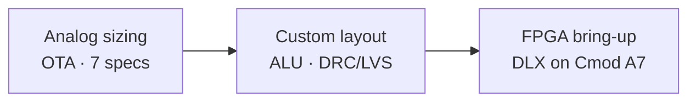

# Jawad Saied Ahmed

**B.Sc. Electrical Engineering · Tel Aviv University**  
RTL design · FPGA bring-up · full-custom VLSI · analog circuits

---

## About

I work across the full silicon stack — from transistor-level analog sizing and custom layout, through RTL and verification, to FPGA bring-up on real hardware.

Most of my digital work follows the same habit: write synthesizable RTL, prove it with self-checking testbenches, gate it with CI, and only then integrate it into a larger block. The repos below are split by project so each one tells a clear story on its own.

## Projects

| | Repository | What you'll find | CI |
|:---:|---|---|:---:|
| 1 | [**dlx-fpga-resa-bringup**](https://github.com/jawadsa02/dlx-fpga-resa-bringup) | DLX processor migration to Artix-7, UART RTL, hardware validation |  |
| 2 | [**alu-vlsi-gpdk45**](https://github.com/jawadsa02/alu-vlsi-gpdk45) | Full-custom ALU in Virtuoso — Knowles adder, layout, clean signoff | — |
| 3 | [**ota-analog-design**](https://github.com/jawadsa02/ota-analog-design) | OTA meeting seven simultaneous specs (100/100 course grade) | — |

## Skills

| Area | Tools | Backed by |
|---|---|---|
| RTL | Verilog, FSM design, Verilator lint | [UART](https://github.com/jawadsa02/dlx-fpga-resa-bringup) |
| Verification | Self-checking testbenches (16 TX, 18 RX, 54 loopback cases) | [DLX bring-up](https://github.com/jawadsa02/dlx-fpga-resa-bringup) |
| FPGA | Vivado 2024.2, Artix-7, USB-UART host link | [DLX bring-up](https://github.com/jawadsa02/dlx-fpga-resa-bringup) |
| Physical design | Virtuoso, DRC/LVS, Yosys synthesis | [ALU flow](https://github.com/jawadsa02/alu-vlsi-gpdk45) |
| Analog | OTA/op-amp, gm/ID sizing, SPICE | [OTA design](https://github.com/jawadsa02/ota-analog-design) |
| Infra | GitHub Actions, Make, Python/C host tools | [DLX CI](https://github.com/jawadsa02/dlx-fpga-resa-bringup/actions/workflows/ci.yml) |

## Education

**Tel Aviv University** — B.Sc. Electrical Engineering (2026)

Analog Electronic Circuits **100** · Electronic Devices **92** · Physics 2 **91** · Computer Architecture **88** · Digital Electronic Circuits **86** · Intro to VLSI **83**

## Languages

Arabic (native) · Hebrew (fluent) · English (fluent)

---

*Open an issue or reach out on LinkedIn if you'd like to walk through any of the designs.*

