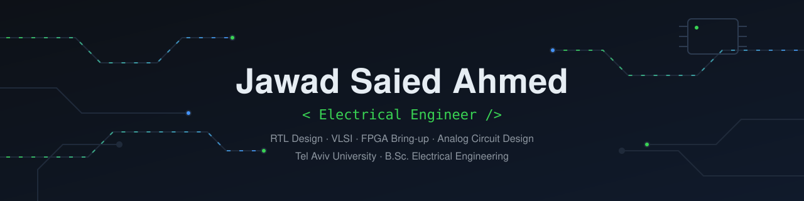
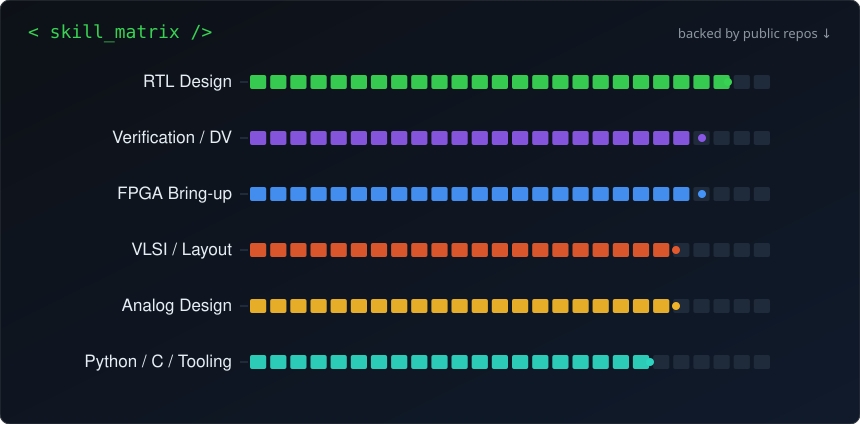

# Jawad Saied Ahmed

**Electrical Engineering Graduate · Tel Aviv University**
*Digital Hardware Design · VLSI · Analog Circuit Design*

---

## 🎯 About Me

B.Sc. Electrical Engineering at **Tel Aviv University**, specializing in the **full VLSI design flow** — from RTL and logic design through schematic capture, full-custom layout, and silicon-aware verification.

- 🔬 Hands-on with **RTL design & FPGA bring-up** (Verilog, Vivado, Artix-7)
- 🧩 **Full-custom VLSI** in Cadence Virtuoso (schematic → floorplan → layout → DRC/LVS)
- 📈 **Analog design** meeting 7 simultaneous specs — *100/100 in Analog Electronic Circuits*
- 💼 Available immediately for **chip design / design verification / chip bring-up** roles

## 🚀 Featured Projects

| Project | Domain | Stack | Highlights |
|---|---|---|---|
| **[DLX Microprocessor on FPGA](https://github.com/jawadsa02/dlx-fpga-resa-bringup)** | RTL · Bring-up | Verilog, Vivado 2024.2, Artix-7 (Cmod A7) | Led bring-up on a new FPGA platform; migrated ISE 14.x → Vivado; designed I/O & bus control; validated with ACSL Labs 1–7 |
| **[ALU — Full-Custom VLSI](https://github.com/jawadsa02/alu-vlsi-gpdk45)** | VLSI · Layout | Cadence Virtuoso, gpdk45 | Knowles adder, registers & subtractor from gate-level schematic to layout; clean **DRC + LVS** |
| **[OTA Analog Amplifier](https://github.com/jawadsa02/ota-analog-design)** | Analog | Cadence Virtuoso, SPICE | Met **7 simultaneous specs** (gain, BW, GBW, phase margin, power, settling) via transistor-sizing iteration |
| **[Triple-Verified FIFO](https://github.com/jawadsa02/sync-fifo-verified)** | RTL · Formal DV | SymbiYosys, z3, Yosys, Icarus | Simulated (994 checks), **formally proven** (data integrity, no overflow), synthesis-gated — 4-job CI |
| **[Buffered UART Subsystem](https://github.com/jawadsa02/uart-buffered-subsystem)** | System Integration | Verilog, Yosys, Icarus | **Composes** uart_tx + uart_rx + 2× sync_fifo into one subsystem; end-to-end verified (12 bytes through the full pipeline) |

## 🛠️ Technical Skills — every skill links to public proof

| Domain | Stack | Proven in |
|---|---|---|
| **RTL Design** |    | [UART TX/RX](https://github.com/jawadsa02/dlx-fpga-resa-bringup), [FIFO](https://github.com/jawadsa02/sync-fifo-verified) — lint-clean, synthesizable |
| **Verification (DV)** |    | [FIFO formal proofs](https://github.com/jawadsa02/sync-fifo-verified) — data integrity *proven*, scoreboards, 1000+ checks |
| **FPGA & Bring-up** |    | [DLX bring-up](https://github.com/jawadsa02/dlx-fpga-resa-bringup) — ISE→Vivado migration, validated on hardware (ACSL Labs 1–7) |
| **VLSI / Physical** |    | [ALU full-custom flow](https://github.com/jawadsa02/alu-vlsi-gpdk45) — schematic→layout→signoff, 33 documented figures |
| **Analog** |    | [7-spec OTA](https://github.com/jawadsa02/ota-analog-design) — 100/100 course grade |
| **Engineering Infra** |     | Every repo: lint → sim → synthesis → formal on each push |

> The difference from a typical skills list: each row is **verifiable** — click through and read the code, the testbench, or the proof.

## 🎓 Education

**Tel Aviv University** — B.Sc. Electrical Engineering *(2026)*
Top coursework: Analog Electronic Circuits **(100)** · Electronic Devices **(92)** · Physics 2 **(91)** · Computer Architecture **(88)** · Digital Electronic Circuits **(86)** · Intro to VLSI **(83)**

## 🌐 Languages

Arabic (native) · Hebrew (fluent) · English (fluent)

---

*“From transistor sizing to processor bring-up — I design across the full stack of silicon.”*

